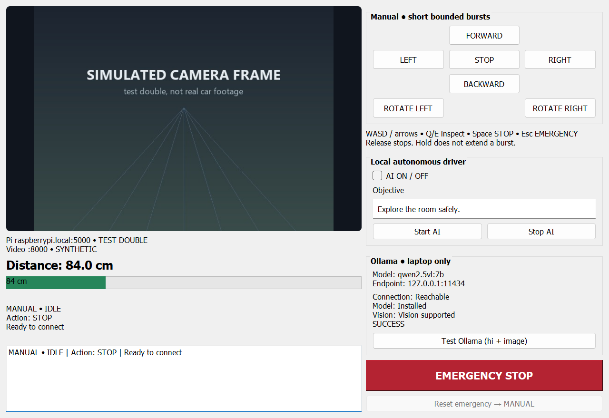
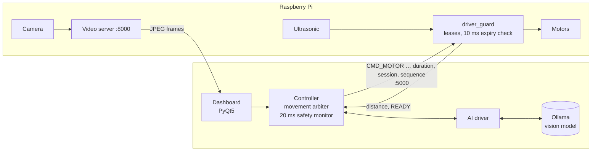

<div align="center">



<br>

**Tell the car what to do in plain English, and a vision model on your laptop drives it, one short, guarded burst at a time.**

[](https://www.python.org/)
[](https://www.raspberrypi.com/)
[](https://ollama.com/)
[](https://riverbankcomputing.com/software/pyqt/)
[](AI_DRIVER_VERIFICATION.md)
[](LICENSE.txt)

[Operating guide](AI_DRIVER_OPERATING_GUIDE.md) · [How it works](AI_DRIVER.md) · [Verification](AI_DRIVER_VERIFICATION.md) · [Original kit](https://github.com/Freenove/Freenove_4WD_Smart_Car_Kit_for_Raspberry_Pi)

</div>

<br>

## What it does

A local AI driver for the [Freenove 4WD Smart Car Kit for Raspberry Pi](https://github.com/Freenove/Freenove_4WD_Smart_Car_Kit_for_Raspberry_Pi). The Pi streams its camera and ultrasonic distance to a dashboard on your laptop. A vision model running in [Ollama](https://ollama.com/) looks at each frame, reads your objective (*"explore the room safely"*), and picks the next move. A guard on the Pi decides whether that move is actually allowed to happen.

<div align="center">

<br>
<sub>The laptop dashboard, rendered with the repo's test doubles: the camera frame and distance are simulated, not real car footage.</sub>
</div>

<br>

<table>
<tr>
<td width="33%" valign="top">

**🧠 Local vision model**<br>
<sub>Any Ollama vision model (default <code>qwen2.5vl:7b</code>) returns a strict JSON decision: action, duration, confidence and status. Nothing leaves your network, and no cloud API is used.</sub>

</td>
<td width="33%" valign="top">

**🛑 Guarded on the Pi**<br>
<sub><code>driver_guard.py</code> owns the motors. Every move is a lease of at most 0.75 s, and the Pi stops on an obstacle within 30 cm, a stale sensor, a disconnect, a malformed command or shutdown.</sub>

</td>
<td width="33%" valign="top">

**🎮 Manual first**<br>
<sub>WASD or the arrow keys send short bursts, and releasing stops. Space stops, Esc is an emergency stop, and any manual input switches the AI off. A late model reply can never restart it.</sub>

</td>
</tr>
</table>

## How it works



1. **See.** The Pi streams JPEG frames and timestamped ultrasonic readings. Old frames and stale readings are rejected, not reused.
2. **Decide.** The controller sends the latest frame and your objective to Ollama, one request at a time. Durations above the limit are rejected, not clamped.
3. **Act.** The move goes to the Pi as a bounded motor command with a session and sequence number. The car stops, settles and looks again before the next decision.
4. **Guard.** The Pi enforces the lease on its own clock. Sensor polls, an open socket or a busy model never extend it.

## Quickstart

> [!IMPORTANT]
> The software chain is implemented and tested against synthetic peripherals, but **physical driving has not been verified yet**. Motor polarity, stopping distance and the 30 cm threshold need testing on the real car first. See [Physical handoff and limitations](AI_DRIVER.md#physical-handoff-and-limitations).

**On the Pi** (from `Code/Server`, after the original Freenove setup):

```bash
python3 main.py --ai-safe --no-gui --bind 0.0.0.0 --command-port 5000 --video-port 8000 --watchdog 1.0 --max-duration 0.75 --threshold 30
```

**On the laptop:**

```bash
python -m venv .venv && source .venv/bin/activate     # Windows: .venv\Scripts\activate
pip install -r requirements-ai.txt
ollama pull qwen2.5vl:7b
cp driver.json driver.local.json                      # set pi_host to your Pi's address
python -m ai_driver --config driver.local.json
```

The [operating guide](AI_DRIVER_OPERATING_GUIDE.md) walks through each step by laptop terminal, Pi over SSH and Pi display. That includes copying the laptop app from the Pi, driving controls and shutdown.

## About this fork

**This is a modified fork, not an official Freenove repository.** It is built on the [Freenove 4WD Smart Car Kit for Raspberry Pi](https://github.com/Freenove/Freenove_4WD_Smart_Car_Kit_for_Raspberry_Pi) by Freenove Creative Technology Co., Ltd., released under [CC BY-NC-SA 3.0](http://creativecommons.org/licenses/by-nc-sa/3.0/). This fork uses the same licence and is for non-commercial use only. It is not affiliated with or endorsed by Freenove.

| | |
|---|---|
| **Added** | The `ai_driver/` package, `Code/Server/driver_guard.py`, `tests/`, `driver.json`, `requirements-ai.txt`, the `AI_DRIVER*.md` documents, the `bugfixes` source-review notes and `docs/assets/` |
| **Modified** | Freenove's `Code/Server/camera.py`, `car.py`, `main.py`, `server.py`, `tcp_server.py` and `ultrasonic.py`, for the guarded AI-safe mode: servo-free startup, timestamped ultrasonic samples, camera frame timeouts and a vertically flipped camera by default. Also this README |
| **Unchanged** | Everything else, including Freenove's tutorials, datasheets, pictures, client and applications |

<br>

---

## Original Freenove kit README

*The rest of this page is Freenove's original README for the kit, kept as published.*


## Freenove 4WD Smart Car Kit for Raspberry Pi

> A 4WD smart car kit for Raspberry Pi.

<div style="text-align: center;">
  
  
</div>

### Connection Board Version
<table>
  <tr>
    <th>PCB Version</th>
    <th>PCB Picture</th>
  </tr>
  <tr>
    <td>V1.0</td>
    <td align="center">
      
    </td>
  </tr>
  <tr>
    <td>V2.0</td>
    <td align="center">
      
    </td>
  </tr>
</table>


### Download

* **Use command in console**

	Run following command to download all the files in this repository.

	`git clone https://github.com/Freenove/Freenove_4WD_Smart_Car_Kit_for_Raspberry_Pi.git`

* **Manually download in browser**

	Click the green "Clone or download" button, then click "Download ZIP" button in the pop-up window.
	Do NOT click the "Open in Desktop" button, it will lead you to install Github software.

> If you meet any difficulties, please contact our support team for help.

### Support

Freenove provides free and quick customer support. Including but not limited to:

* Quality problems of products
* Using Problems of products
* Questions of learning and creation
* Opinions and suggestions
* Ideas and thoughts

Please send an email to:

[support@freenove.com](mailto:support@freenove.com)

We will reply to you within one working day.

### Purchase

Please visit the following page to purchase our products:

http://store.freenove.com

Business customers please contact us through the following email address:

[sale@freenove.com](mailto:sale@freenove.com)

### Copyright

All the files in this repository are released under [Creative Commons Attribution-NonCommercial-ShareAlike 3.0 Unported License](http://creativecommons.org/licenses/by-nc-sa/3.0/).


This means you can use them on your own derived works, in part or completely. But NOT for the purpose of commercial use.
You can find a copy of the license in this repository.

Freenove brand and logo are copyright of Freenove Creative Technology Co., Ltd. Can't be used without formal permission.


### About

Freenove is an open-source electronics platform.

Freenove is committed to helping customer quickly realize the creative idea and product prototypes, making it easy to get started for enthusiasts of programing and electronics and launching innovative open source products.

Our services include:

* Robot kits
* Learning kits for Arduino, Raspberry Pi and micro:bit
* Electronic components and modules, tools
* Product customization service

Our code and circuit are open source. You can obtain the details and the latest information through visiting the following web site:

http://www.freenove.com
